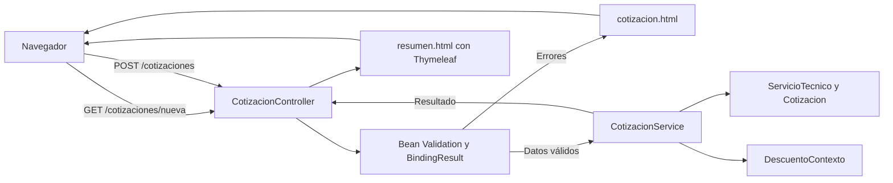
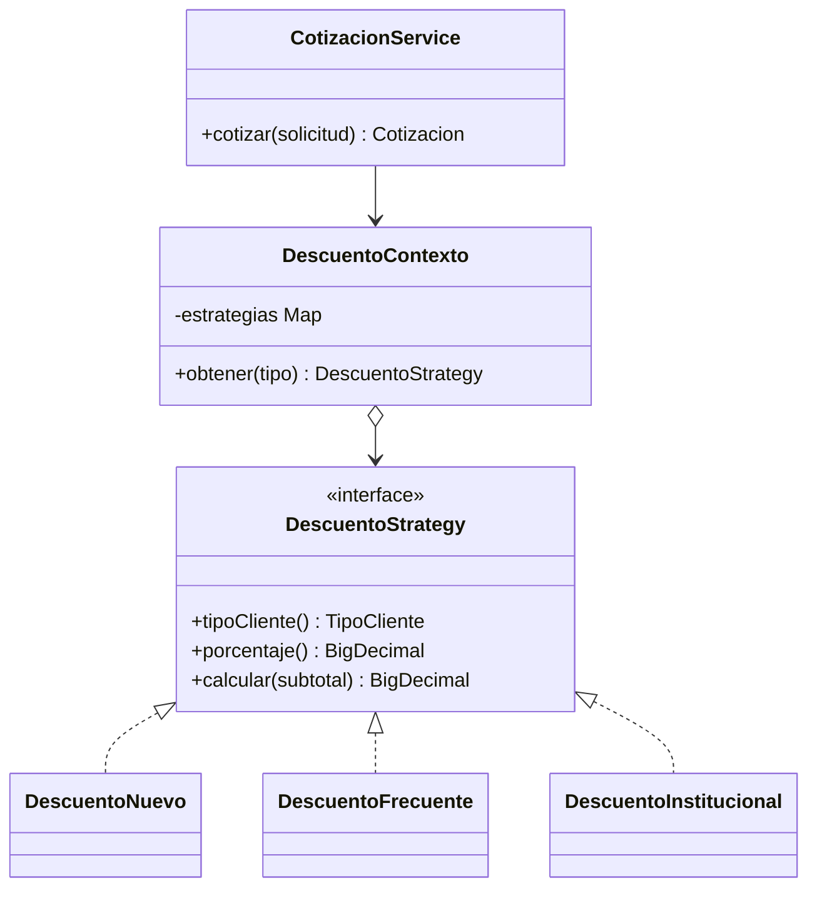
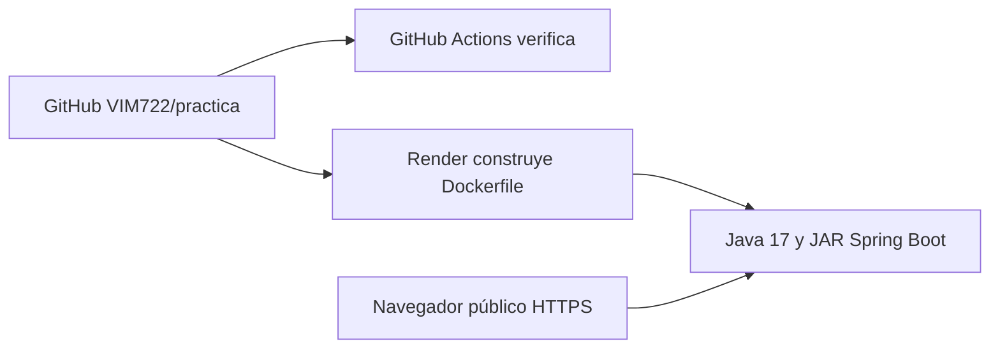

# Arquitectura de TecnoSoporte

El formulario y el resumen se renderizan en el servidor con Thymeleaf. El precio procede de `ServicioTecnico`; el cliente solo envía nombre, servicio, cantidad y tipo. El navegador puede anticipar importes, pero Java siempre calcula el resultado definitivo con `BigDecimal` y escala de dos decimales.

## MVC y flujo de datos

El controlador no calcula subtotal ni descuentos. Un error de conversión o validación devuelve el formulario con los datos y mensajes correspondientes. Una entrada válida produce un resultado inmutable. No se utiliza persistencia: el enunciado no exige una base de datos ni un historial de solicitudes.

## Strategy

Spring inyecta todas las implementaciones `@Component` como una lista. `DescuentoContexto` construye un registro por `TipoCliente` y falla al iniciar si hay duplicados o falta una política. La selección utiliza el registro, no una cadena `if/else` ni `switch` que reúna los descuentos. El método predeterminado `calcular` se puede sobrescribir si una política futura necesita otro algoritmo.

Para una nueva categoría: agregar el valor a `TipoCliente` y crear su implementación del contrato. El controlador obtiene las categorías del enum y las tasas desde el contexto; no requiere incorporar condiciones nuevas. El registro rechaza una configuración incompleta.

## Reglas y decisiones

Subtotal = precio autorizado × cantidad. Descuento = subtotal × porcentaje / 100, redondeado a dos decimales con `HALF_UP`. Total = subtotal − descuento. Los precios base ya tienen dos decimales. No se incorpora IGV u otro cargo porque el enunciado no lo solicita.

`SolicitudCotizacion` usa Jakarta Bean Validation. Spring convierte los enums y el entero; los errores de conversión reciben mensajes en español en `messages.properties`. `@InitBinder` admite únicamente cuatro campos; los importes recibidos por el navegador se ignoran. Las vistas usan `th:text` y campos escapados para mostrar nombres como texto.

`/health` expone solo el estado de disponibilidad. No hay autenticación ni persistencia porque se trata de un cotizador público sin operaciones de administración. El contenedor ejecuta el JAR como usuario sin privilegios. No se necesitan secretos.

## Componentes verificables

| Requisito | Implementación |
| --- | --- |
| RF01 | Aplicación principal, `pom.xml`, wrapper y Dockerfile |
| RF02 RF06 RF07 | `SolicitudCotizacion`, `cotizacion.html` y validación MVC |
| RF03 RF09 | `CotizacionService` |
| RF04 RF05 RF10 | Controlador GET/POST y `resumen.html` |
| RF08 | Interfaz, tres estrategias y contexto |
| RF11 | Este documento y diagramas del informe |

## Despliegue

Aplicación publicada: [TecnoSoporte en Render](https://tecnosoporte-pc3.onrender.com/cotizaciones/nueva). La instancia superó 16 comprobaciones HTTP públicas y los casos mínimos en navegador el 14 de noviembre de 2026. Los resultados y capturas están en `docs/evidencias/`. El identificador exacto del commit desplegado debe consultarse en el panel de Render; no se deduce únicamente de la URL.
